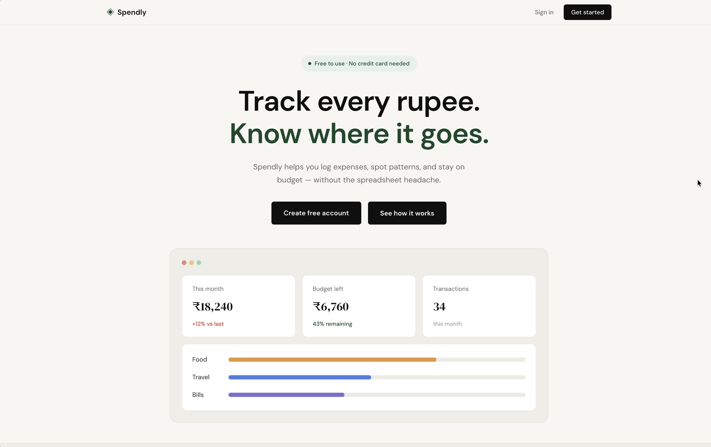
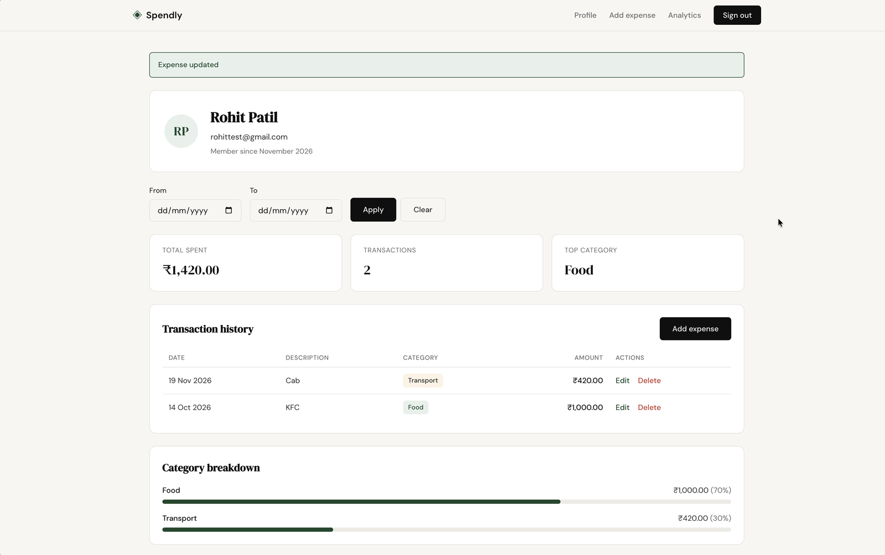
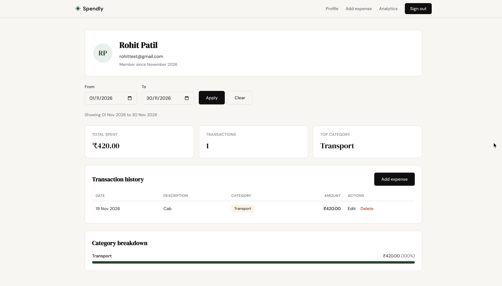
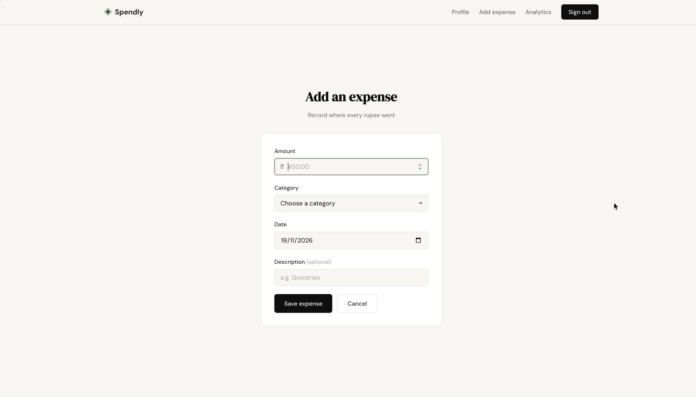
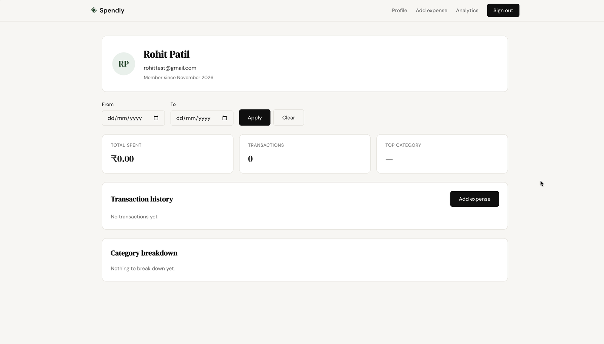
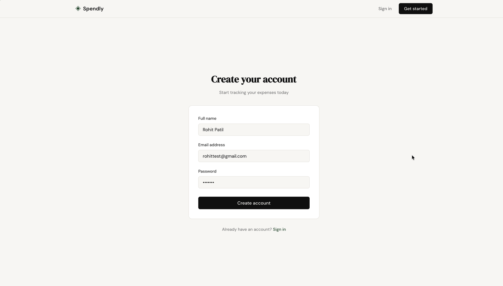
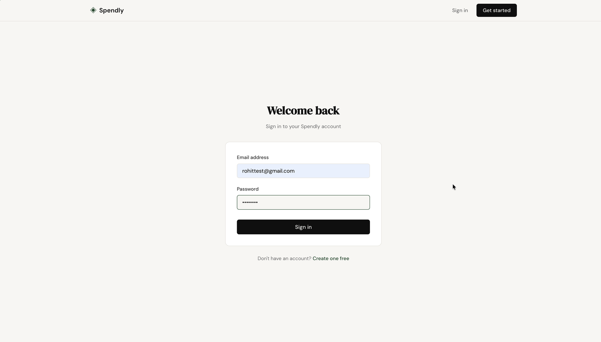
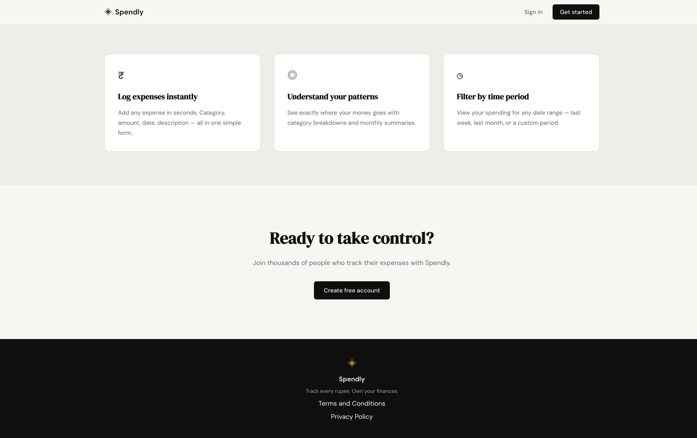
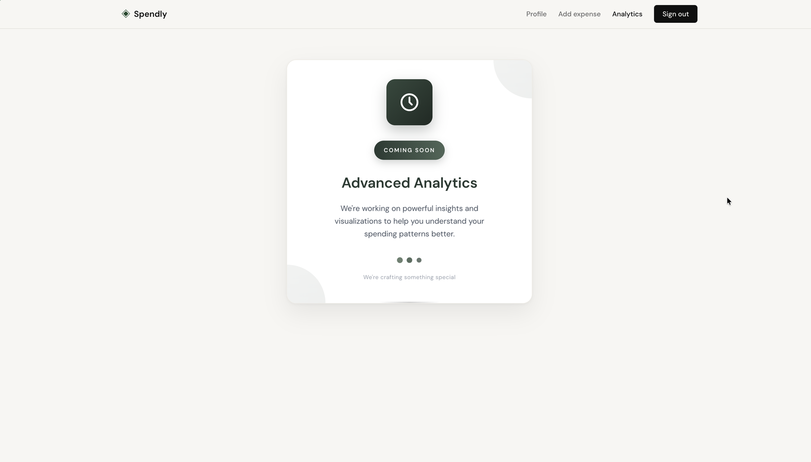
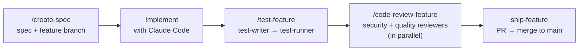

# Spendly

**Track every rupee.** A personal expense tracker web app (Flask + SQLite, INR), built end to end with **Claude Code** as a hands-on project in agentic, spec-driven development.


I'm a senior iOS engineer, and this is a full web backend personal project I built while following CampusX's [Agentic Coding using Claude Code](https://youtube.com/playlist?list=PLKnIA16_RmvaYH3poI0oJvbDF4zEvpq8W) course. The app itself is deliberately simple. The interesting part is **how** it was built: each feature started as a written spec, went onto its own branch, was tested and reviewed by Claude Code subagents, and was merged through a pull request.

<p align="center">
  
</p>

---

## Features

- **Accounts:** register, log in and log out. Passwords are hashed with Werkzeug (scrypt), and the session cookie is `SameSite=Lax`. Login shows one generic error, so it never reveals whether an email is registered.
- **Dashboard:** total spent, number of transactions, top category, transaction history and a per-category breakdown.
- **Date-range filter:** filters every number on the dashboard. Invalid ranges fall back to unfiltered data with a clear message.
- **Add, edit and delete expenses** with server-side validation:
  - amounts up to ₹1,00,00,000, with at most 2 decimals
  - no future dates
  - a fixed category list
  - descriptions up to 200 characters
- **Ownership checks:** another user's expense returns `404`, exactly like a missing one, so ids can't be probed.
- **Indian number formatting** through a custom Jinja filter, e.g. `₹1,23,456.00`.
- **Responsive layout** for desktop and mobile.
- **Analytics:** placeholder page, coming soon.

## Screenshots

| Dashboard | Date-range filter |
|---|---|
|  |  |
| **Add expense** | **New account (empty state)** |
|  |  |
| **Create account** | **Sign in** |
|  |  |
| **Landing page** | **Analytics (coming soon)** |
|  |  |

## How it was built with Claude Code

Everything that drove the build lives in [`.claude/`](.claude) and [`CLAUDE.md`](CLAUDE.md), so the workflow can be inspected alongside the code.



| Claude Code feature | What I set up |
|---|---|
| **CLAUDE.md** | Project memory: architecture, commands, and conventions such as INR-only amounts and area-prefixed commit messages. |
| **Specs** | [`.claude/specs/`](.claude/specs). Nine numbered feature specs (database, registration, login, profile, date filter, add, edit and delete expense), each written before the code. |
| **Slash commands** | `/create-spec` (spec + branch), `/test-feature`, `/code-review-feature`, `/seed-user`, `/seed-expense`. |
| **Subagents** | `spendly-test-writer` writes pytest tests **from the spec, not the implementation**. `spendly-test-runner` runs and analyses them. `spendly-security-reviewer` and `spendly-quality-reviewer` review the same diff **in parallel**, with read-only tools. |
| **Skills** | `frontend-design` (the project's design system for Jinja templates and CSS) and `ship-feature` (commit, PR, merge, clean up). |
| **Hooks** | `PostToolUse` auto-formats every edited Python file with `black`. `PreToolUse` blocks destructive shell commands on the database, `.env` and migrations. |
| **Plugins** | Railway plugin for deployment. |

## Tech stack

- **Backend:** Python 3.13, Flask 3.1, Jinja2 server-side rendering
- **Database:** SQLite through Python's `sqlite3` (no ORM), with foreign keys enforced
- **Frontend:** plain HTML templates, CSS and vanilla JavaScript
- **Testing:** pytest + pytest-flask, with **291 tests** covering the database layer, auth, dashboard, date filtering and every expense flow
- **Deployment:** gunicorn on [Railway](https://railway.com), via `Procfile`

## Run it locally

```bash
git clone https://github.com/rohit009/spendly.git
cd spendly
python3 -m venv venv
venv/bin/pip install -r requirements.txt
venv/bin/python app.py          # http://localhost:5001
```

The database is created and seeded on first run. Log in with the demo account **demo@spendly.com / demo123**.

Run the tests:

```bash
venv/bin/pytest
```

For production, set a `SECRET_KEY` environment variable so sessions survive restarts.

## Project structure

```
app.py               # Routes, validation, Jinja filters
database/
  db.py              # Connection, schema, seed data
  queries.py         # All SQL: stats, breakdowns, expense CRUD (scoped to the user)
templates/           # Jinja2 pages extending base.html
static/              # CSS and JS
tests/               # pytest suite
scripts/             # Seed scripts used by /seed-user and /seed-expense
.claude/             # Specs, slash commands, subagents, skills, hooks
learning/            # My notes on the Python, Flask and SQL used here
```

## Learning notes

Coming from iOS, I asked Claude Code to explain the backend in terms I already knew:

- [`Spendly_Technical_Doc.md`](Spendly_Technical_Doc.md) maps the architecture and request lifecycle to iOS concepts.
- [`learning/`](learning) holds topic guides for the Python, Flask and database ideas this project actually uses.

## Credits

Built by following CampusX's [Agentic Coding using Claude Code](https://youtube.com/playlist?list=PLKnIA16_RmvaYH3poI0oJvbDF4zEvpq8W) course.
